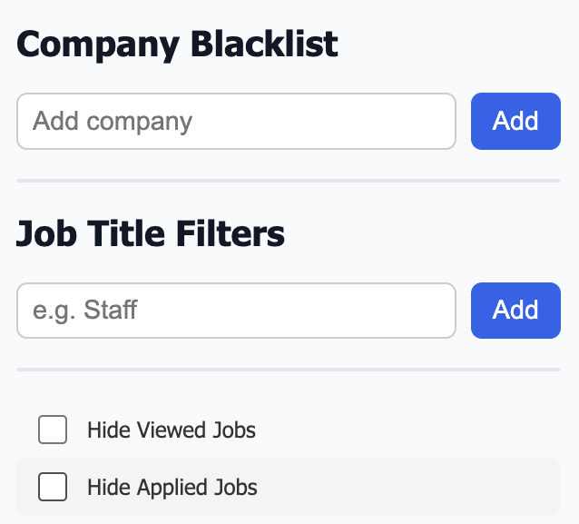

# LinkedIn Job Filter Chrome Extension

<div align="center">



**A Chrome extension to filter LinkedIn job listings by company blacklist, job title keywords, and viewing status**

[](https://opensource.org/licenses/MIT)
[](https://www.google.com/chrome/)

</div>

---

## Table of Contents

- [Overview](#overview)
- [Features](#features)
- [Installation](#installation)
  - [Quick Install](#quick-install)
  - [Developer Installation](#developer-installation)
- [Usage](#usage)
- [How It Works](#how-it-works)
- [Project Structure](#project-structure)
- [Known Issues](#known-issues)
- [Contributing](#contributing)
- [FAQ](#faq)
- [License](#license)
- [Disclaimer](#disclaimer)

---

## Overview

This Chrome extension helps you filter out unwanted job listings on LinkedIn. You can blacklist companies, filter by job title keywords, and hide jobs you've already viewed, applied to, or saved.

The extension works directly on LinkedIn's job search pages and filters listings in real-time as you scroll.

---

## Features

**Company Blacklist**  
Add companies you don't want to see job listings from. Jobs from blacklisted companies are automatically hidden.

**Job Title Filtering**  
Exclude jobs containing specific keywords in their titles (e.g., "Senior", "Staff", "Platform Engineer").

**Hide Viewed Jobs**  
Automatically hide jobs you've already clicked on to keep your feed focused on new opportunities.

**Hide Applied Jobs**  
Remove jobs you've already applied to from your search results.

**Hide Saved Jobs**  
Keep jobs you've saved from appearing in your active search.

**Dynamic Filtering**  
The extension monitors the page and filters new jobs as they load when you scroll.

**Synced Preferences**  
Your filters and settings are saved using Chrome's sync storage and work across all your Chrome browsers.

---

## Installation

### Quick Install

1. Click the green **Code** button at the top of this repository and select **Download ZIP**

2. Unzip the downloaded file. You should get a folder named `linkedin-job-filter-main`

3. Open Chrome and navigate to `chrome://extensions/`

4. Enable **Developer mode** using the toggle in the top-right corner

5. Click **Load unpacked** in the top-left and select the `linkedin-job-filter-main` folder

6. The extension should now appear in your extensions list

**Important notes:**

- Sometimes the zip file creates nested folders. If you see another folder inside the main folder, use that inner folder when loading the extension.
- The extension must be loaded from the folder containing `manifest.json`
- This extension only works with LinkedIn's standard job search, not the beta AI job search

### Developer Installation

```bash
git clone https://github.com/shaunkapla/linkedin-job-filter.git
cd linkedin-job-filter
```

Then load the extension:

1. Open `chrome://extensions/`
2. Enable "Developer mode"
3. Click "Load unpacked"
4. Select the repository folder

---

## Usage

**Initial Setup**

1. Click the extension icon in your Chrome toolbar (you may need to click the puzzle piece icon first)
2. Pin the extension for easier access
3. Navigate to [linkedin.com/jobs/search](https://www.linkedin.com/jobs/search/)
4. Click the extension icon to configure your filters

**Adding Filters**

To blacklist a company:

1. Type the company name in the "Add company" field
2. Click "Add"
3. Reload the LinkedIn page

To filter by job title:

1. Type keywords to exclude (e.g., "Senior", "Manager")
2. Click "Add"
3. Reload the LinkedIn page

**Managing Filters**

- Click "remove" next to any company or keyword to delete it
- Check or uncheck the boxes to toggle hiding viewed/applied jobs
- All changes require a page reload to take effect

**Notes**

- Your settings sync across Chrome browsers where you're signed in
- After changing any filter, reload the LinkedIn page to see the changes
- The extension automatically filters jobs as they load when you scroll

---

## How It Works

The extension uses a content script that runs on LinkedIn job search pages. Here's the basic flow:

1. **Initialization**: Loads your saved filters from Chrome storage
2. **DOM Monitoring**: Uses MutationObserver to watch for new job cards as they load
3. **Filtering Logic**: For each job card, checks:
   - Company name against your blacklist
   - Job title against your keyword filters
   - Whether the job has been viewed, applied to, or saved
4. **Session Tracking**: Uses sessionStorage to remember which jobs you've clicked during the current session
5. **Dynamic Updates**: Listens for changes to your filters and re-applies them without reloading

The extension applies CSS to hide filtered jobs (`display: none`) or dim viewed jobs (`opacity: 0.5`) based on your settings.

---

## Project Structure

```
linkedin-job-filter/
├── manifest.json          # Extension configuration
├── popup.html             # Extension popup interface
├── popup.css              # Popup styling
├── popup.js               # Popup logic and storage management
├── content.js             # Main filtering logic
├── icon.png               # Extension icon
└── README.md              # Documentation
```

**File Descriptions**

- `manifest.json` - Defines permissions, content scripts, and extension metadata
- `popup.html/css/js` - The user interface for managing filters
- `content.js` - Core filtering engine that runs on LinkedIn pages

---

## Known Issues

**Fixed Issues**

1. **Job disappearing on click** - Previously, clicking a job would immediately hide it from the sidebar. This has been fixed by tracking clicked jobs in sessionStorage. [PR #1](https://github.com/shaunkapla/linkedin-job-filter/pull/1)

2. **Page freeze when searching blacklisted companies** - Searching for a company in your blacklist would freeze the page. This has been resolved. [PR #2](https://github.com/shaunkapla/linkedin-job-filter/pull/2)

**Remaining Issues**

1. **Save job instant removal** - When you save a job with "Hide Saved Jobs" enabled, it immediately disappears from view. Workaround: temporarily disable the setting when saving jobs.

Note: This project is no longer actively maintained. Feel free to fork and continue development if you'd like to fix these issues or add new features.

---

## Contributing

While I'm no longer actively developing this extension, contributions are welcome. If you want to improve the extension or fix bugs:

1. Fork the repository
2. Create a branch for your changes
3. Make your changes and test them on LinkedIn
4. Submit a pull request with a clear description

Please maintain the existing code style and include comments where appropriate.

---

## FAQ

**Does this violate LinkedIn's Terms of Service?**  
The extension only modifies how jobs are displayed in your browser. It doesn't interact with LinkedIn's servers in unusual ways or scrape data. However, use it at your own risk.

**Will LinkedIn ban me for using this?**  
The extension operates client-side and doesn't do anything that would trigger LinkedIn's anti-bot measures. That said, I can't guarantee anything.

**Can I use this on mobile?**  
No, this is a desktop Chrome extension. Mobile browsers don't support Chrome extensions.

**Does this work with LinkedIn Premium?**  
Yes, it works with both free and premium accounts.

**Why do I need to reload after changing filters?**  
The content script needs to reinitialize with your new settings. It's a limitation of how Chrome extensions work.

**Does this slow down LinkedIn?**  
No, the extension is lightweight and shouldn't cause any noticeable performance impact.

**What data does this collect?**  
None. Everything is stored locally in Chrome storage. Nothing leaves your browser.

---

## License

MIT License

Copyright (c) 2025 Shaun Kapla

Permission is hereby granted, free of charge, to any person obtaining a copy
of this software and associated documentation files (the "Software"), to deal
in the Software without restriction, including without limitation the rights
to use, copy, modify, merge, publish, distribute, sublicense, and/or sell
copies of the Software, and to permit persons to whom the Software is
furnished to do so, subject to the following conditions:

The above copyright notice and this permission notice shall be included in all
copies or substantial portions of the Software.

THE SOFTWARE IS PROVIDED "AS IS", WITHOUT WARRANTY OF ANY KIND, EXPRESS OR
IMPLIED, INCLUDING BUT NOT LIMITED TO THE WARRANTIES OF MERCHANTABILITY,
FITNESS FOR A PARTICULAR PURPOSE AND NONINFRINGEMENT. IN NO EVENT SHALL THE
AUTHORS OR COPYRIGHT HOLDERS BE LIABLE FOR ANY CLAIM, DAMAGES OR OTHER
LIABILITY, WHETHER IN AN ACTION OF CONTRACT, TORT OR OTHERWISE, ARISING FROM,
OUT OF OR IN CONNECTION WITH THE SOFTWARE OR THE USE OR OTHER DEALINGS IN THE
SOFTWARE.

---

## Disclaimer

This project is an independent tool created for personal use.

**It is not affiliated with, endorsed by, or connected to LinkedIn Corporation.**

All trademarks and logos are the property of their respective owners.

**Use at your own risk.** The author is not responsible for:

- Violations of LinkedIn's Terms of Service
- Account suspension or termination
- Data loss
- Any other damages

By using this extension, you agree to comply with LinkedIn's terms of service and all applicable laws.

---

<div align="center">

Made by Shaun Kapla

</div>
